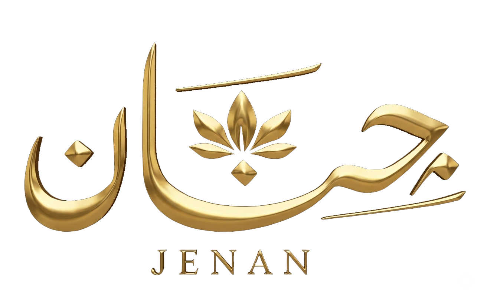

<div align="center">

  

  # ✨ جنان لوكشري | Janan Luxury ✨
  ### *فخامة تليق بكِ — أرقى تشكيلة من العبايات الملكية والتصاميم الحصرية*

  <p align="center">
    <a href="https://jenan-brand.netlify.app" target="_blank">
      
    </a>
    
    
    
    
  </p>

  <p align="center">
    <b>منصة وتجربة تسوق إلكترونية فاخرة متخصصة في أرقى العبايات والأزياء الملكية الخليجية والعربية.</b>
  </p>

  ---

  [🌐 معاينة الموقع مباشرة (Live Demo)](https://jenan-brand.netlify.app) • [✨ المميزات](#-المميزات-الرئيسية) • [🛠️ التقنيات](#️-التقنيات-المستخدمة) • [📁 هيكل المشروع](#-هيكل-المشروع) • [🚀 طريقة التشغيل](#-طريقة-التشغيل-محليا)

</div>

<br/>

## 📖 نبذة عن المشروع

**جنان لوكشري (Janan Luxury)** هو متجر إلكتروني متكامل للواجهة الأمامية (Front-End E-Commerce) مصمم خصيصاً لعلامة تجارية متخصصة في العبايات الفاخرة والمصممة يدوياً.
يتميز المتجر بهوية بصرية راقية تمزج بين الفخامة الملكية (الذهبي المطفي والدرجات الداكنة) وسلاسة تجربة المستخدم (UI/UX) مع تفاعلات لحظية وسريعة.

---

## 🌟 المميزات الرئيسية

- 👑 **هوية بصرية فاخرة وأنيقة:** تناغم لوني بين الذهبي الفاخر والأخضر الملكي الداكن، مع خطوط عربية أصيلة (`Cairo` و `Amiri`).
- 🎬 **شاشة ترحيب تفاعلية (3D Intro Preloader):** حركة ثلاثية الأبعاد لشعار الماركة مع تأثيرات تحميل انسيابية عند بدء الزيارة.
- 📱 **تصميم متجاوب بالكامل (Fully Responsive):** تجربة تصفح متكاملة ومتوافقة مع شاشات الهواتف الذكية، الأجهزة اللوحية، والشاشات الكبيرة.
- 🛍️ **حقيبة تسوق ذكية (Interactive Popdown Cart):**
  - إضافة المنتجات فوراً وتحديث العداد والشارة تلقائياً.
  - إمكانية حذف العناصر دون إغلاق نافذة السلة.
  - حساب فوري للإجمالي مع دعم الأرقام العربية والإنجليزية وتنسيق العملة (`ج.م`).
  - حفظ محتويات السلة محلياً في المتصفح (`LocalStorage`) لضمان عدم ضياع المنتجات عند إعادة التحميل.
- 💖 **قائمة المفضلة (Wishlist):** تمكين العميل من تمييز القطع المحببة بضغطة زر وتخزينها بالذاكرة المحلية.
- 🔍 **صفحة تفاصيل منتج تفاعلية (`details.html`):**
  - عرض ديناميكي لبيانات وصور المنتج المختار.
  - معرض صور مصغرة (Image Thumbnails Gallery) مع انتقال سلس عند التبديل.
  - عرض المواصفات ومقترحات لمنتجات مشابهة.
- 💬 **طلب مباشر عبر واتساب (WhatsApp Direct Order):**
  - توليد رسالة منظمة تلقائياً تحتوي على تفاصيل كافة المنتجات المختارة والأسعار والإجمالي، وإرسالها مباشرة لرقم المتجر الرسمي.
- ⚡ **أداء فائق وتحسين محركات البحث (SEO Optimized):**
  - دعم كامل للبيانات الوصفية (Open Graph، Twitter Cards، Google Site Verification).
  - ملف `sitemap.xml` مهيأ لأرشفة محركات البحث.

---

## 🛠️ التقنيات المستخدمة

| التقنية / الأداة | الاستخدام |
| :--- | :--- |
| **HTML5 (Semantic)** | البنية الهيكلية للموقع ودعم اللغة العربية واتجاه النص (`dir="rtl"`) ومحددات الـ SEO |
| **CSS3** | التنسيقات المتقدمة، الفليكس بوكس والجريد، الأنيميشن والتأثيرات الحركية، وتجاوب الشاشات (`Media Queries`) |
| **Vanilla JavaScript (ES6+)** | إدارة الحالة (State Management)، التفاعل مع DOM، الربط مع الـ LocalStorage، والعمليات الحسابية |
| **Google Fonts** | خطوط عربية فاخرة (`Cairo` & `Amiri`) |
| **Font Awesome 6** | حزمة أيقونات عصرية للمتجر والسوشيال ميديا وقوائم التصفح |
| **Netlify** | استضافة ونشر سحابي سريع مع تحديث فوري |

---

## 📁 هيكل المشروع

```text
جنان/
├── index.html                   # الصفحة الرئيسية للمتجر
├── style.css                    # التنسيقات والأنماط الخاصة بالصفحة الرئيسية
├── script.js                    # المنطق البرمجي، السلة، المفضلة وتفاعلات الرئيسية
├── details.html                 # صفحة تفاصيل المنتج
├── details.css                  # أنماط وتنسيقات صفحة تفاصيل المنتج
├── details.js                   # المنطق البرمجي لمعرض الصور وإدارة التفاصيل
├── sitemap.xml                  # خريطة الموقع لمحركات البحث
├── google28c419dbf8c68549.html   # ملف تأكيد ملكية النطاق لـ Google Search Console
├── image/                       # مجلد الصور الأساسية والشعارات وصور المنتجات
│   ├── logo.png
│   ├── back_video.mp4
│   └── جنان1.jpeg ...
└── image-details/               # مجلد الصور الإضافية لمعارض المنتجات
```

---

## 🚀 طريقة التشغيل محلياً

لتشغيل المشروع على جهازك الشخصي، اتبع الخطوات التالية:

### 1. استنساخ المستودع (Clone Repository)
```bash
git clone https://github.com/alashry252/janan.git
```

### 2. الدخول لمجلد المشروع
```bash
cd janan
```

### 3. التشغيل
المشروع مبني بتقنيات الويب القياسية (Static Site)، لذا يمكنك تشغيله مباشرة:
- عبر فتح ملف `index.html` في أي متصفح ويب.
- أو عبر إضافة **Live Server** في محرر VS Code للحصول على ميزة التحديث التلقائي (Live Reload).

---

## 🌐 المعاينة الحية

يمكنك تجربة الموقع والتسوق الحي عبر الرابط المباشر:  
👉 **[https://jenan-brand.netlify.app](https://jenan-brand.netlify.app)**

---

## 👨‍💻 المطور

تم التطوير والتصميم بواسطة **[يوسف العشري (Yousef Alashry)](https://github.com/alashry252)**  
- **GitHub:** [@alashry252](https://github.com/alashry252)
- **Email:** ywsfalshry236@gmail.com

---

<div align="center">
  <sub>صنع بـ ❤️ وشغف لإبراز الفخامة والأناقة العربية © جنان لوكشري</sub>
</div>
